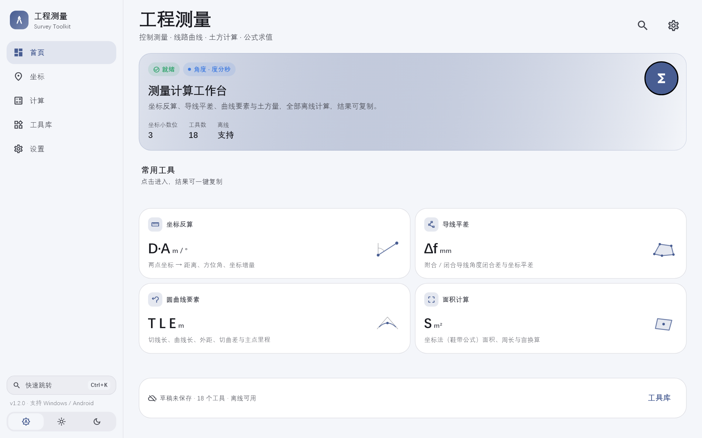
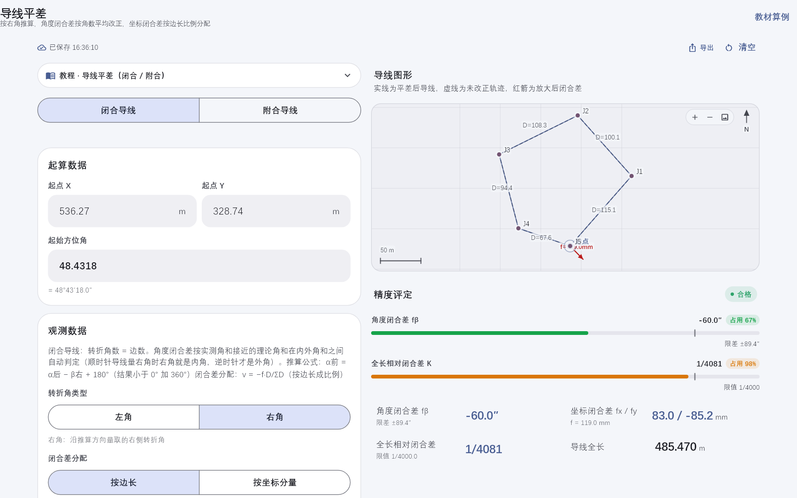
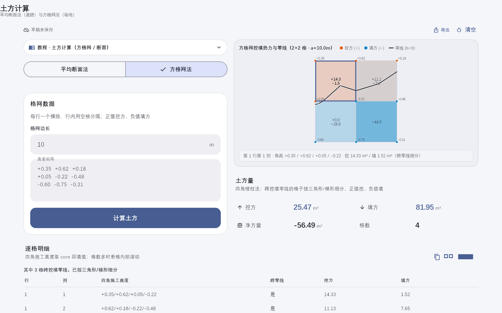
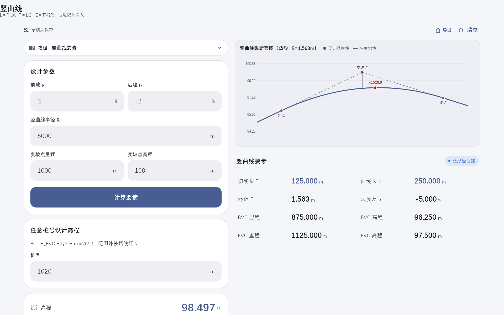
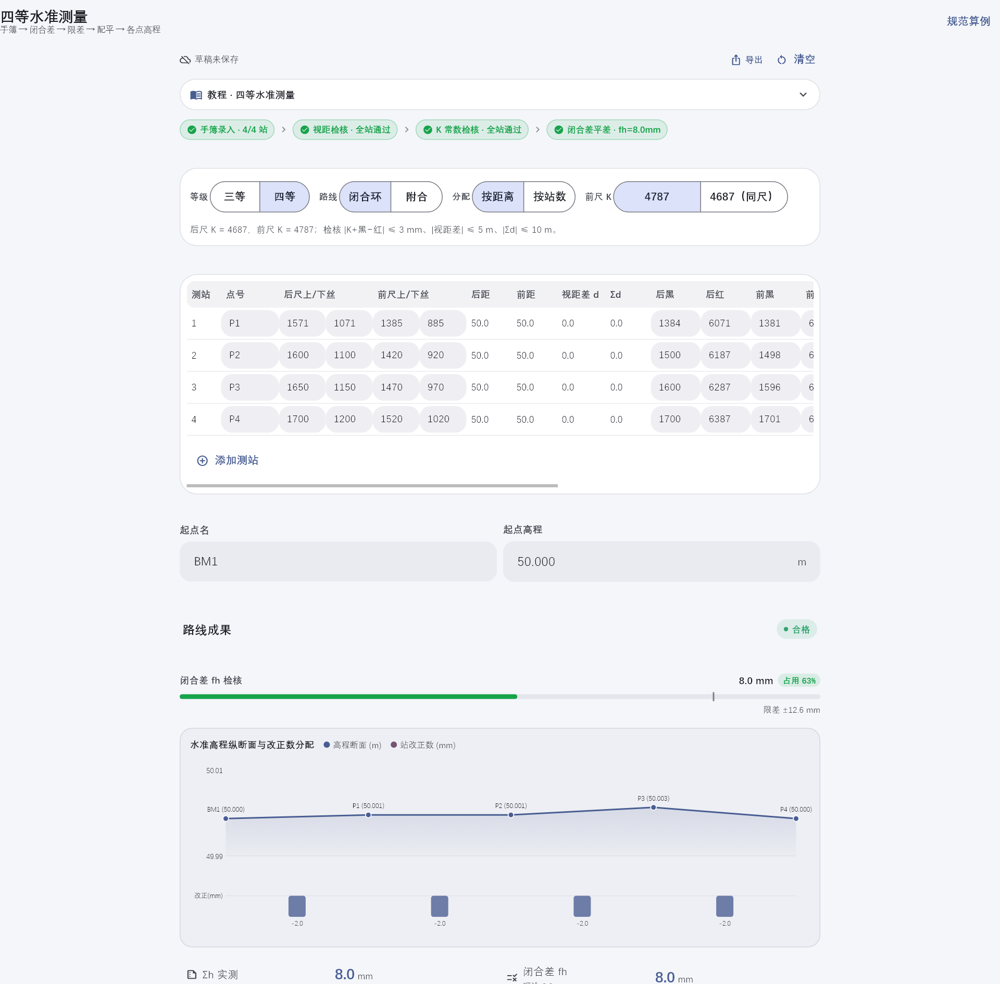
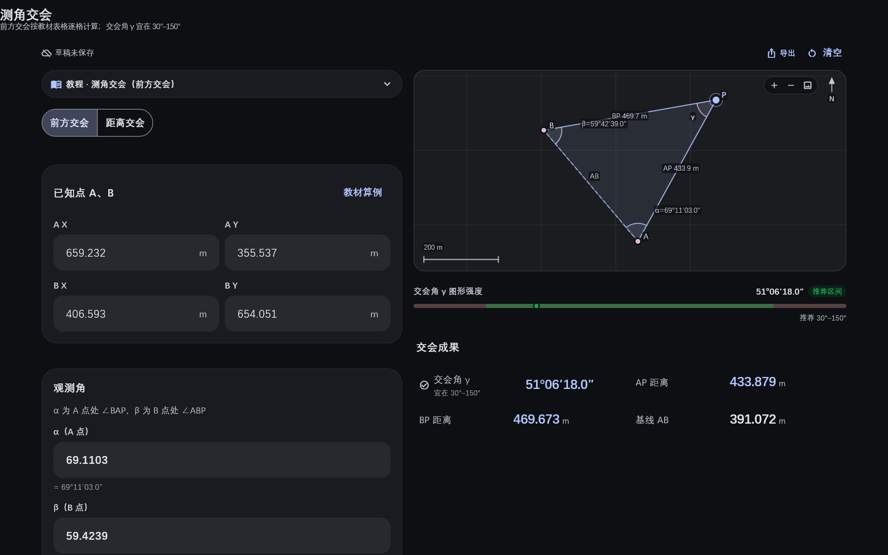

  
  <h1>工程测量工具箱（遵义版）v1.2.0</h1>
  
面向工程测量现场与教学算例的纯离线桌面 / 移动端计算工具箱 · 交互式坐标绘图 · 专项工程图表 · 一键导出

  

    <a href="https://github.com/gtnb233-dev/GTnb233/releases/tag/v1.2.0-win"><strong>Windows x64 便携版下载 (v1.2.0-win)</strong></a>
    ·
    <a href="https://github.com/gtnb233-dev/GTnb233/releases/download/v1.2.0-win/survey_pro-1.2.0-windows-x64.zip">直接下载 ZIP (11.0 MB)</a>
  

---

## 核心功能与设计特点

### 1. 宽屏双栏工作区与高效交互（桌面端深度优化）
- **自适应双栏工作台**：窗口宽度 `>= 980dp` 时自动切换为「左栏参数录入 + 右栏图形与精度检核 + 下方全宽成果表」，告别频繁上下翻找；窄屏 / 手机端自动回落流畅单栏（已通过 `320×640` / `1.3×` 放大字体无溢出回归测试）。
- **`Ctrl+K` 全局命令面板**：随时按 `Ctrl+K`（macOS 为 `Cmd+K`）或点击侧边栏/页眉搜索按钮，模糊检索全部 **19 个测量工具**与内置**测量公式库**，键盘 `↑/↓/Enter` 一键直达。
- **输入草稿防抖落盘**：所有计算页输入自动本地保存，切换页面或重开软件自动恢复，首页快捷卡片实时显示未清草稿小圆点；支持一键「清空」并同步重置持久化草稿。
- **Windows 原生集成**：自动居中启动并限制最小窗口尺寸；支持读取 Windows DWM 强调色（莫奈取色），窗口标题栏实时跟随深浅色主题切换；无命令行黑窗、免安装 VC++ / .NET 运行库，解压即用。

### 2. 交互式实时坐标图（`LivePlot`）
- **等比例工程平面绘图**：自动适配包围盒并保留安全边距，采用 `1 / 2 / 5 × 10^n` 规范比例尺、自适应网格步长与指北针。
- **图上直拖改写坐标**：在坐标反算、正算、放样、交会、面积页面可直接拖动控制点实时更新坐标并联动重算。
- **桌面端操作工具栏**：支持滚轮/按钮放大缩小、`复位全图`、鼠标悬停实时十字准星坐标 HUD，以及右上角一键**导出高清 PNG** 附图。
- **丰富几何图元**：支持半透明闭合地块/交会三角形填充（`PlotPolygon`）、水平角/交会角扇形弧标注（`PlotArc`）、闭合差/残差放大矢量箭头（`PlotArrow`）以及曲线/平差前对比虚线路径（`PlotPath`）。

### 3. 工程专项可视化图表与限差检核仪表
- **`ToleranceGauge` 限差仪表条**：用颜色与刻度直观显示闭合差占限差百分比（余量进度或超限提示），交会角 `γ` 采用推荐区间模式直观标示 `30°–150°` 图形强度。
- **`PipelineStrip` 检核流水条**：四等水准测量页按「手簿录入 → 视距检核 → K 常数检核 → 闭合差平差」分步亮灯提示，异常站点秒级定位。
- **四大工程专项图表**：
  - **方格网土方挖填热力图 + 零线图**（支持点击网格查看四角施工高程、跨零线三角形/梯形细分与挖填方量）；
  - **平均断面面积沿线变化包络图**；
  - **竖曲线纵断面图**（设计二次抛物线、前后坡切线延长线、外距 `E` 与任意查询桩号高程点）；
  - **水准高程纵断面与逐站改正数双向柱状图**；
  - 另有**四/七参数逐点残差矢量分布图**与**批量放样图/表点击双向联动高亮**。

### 4. 完全离线计算与多格式无损导出
- **真表格级导出**：支持 **Excel（`.xlsx`，纯手写 OOXML 无需第三方插件，保留前导零且 Excel 无修复弹窗）**、**CSV（UTF-8 BOM 防中文乱码）**、**TXT 文本对齐** 及 **PNG 图形保存**；Windows 导出后可直接点击「打开文件夹」定位。
- **紧贴测量教材与规范**：
  - 闭合导线右角按实测角和在 `(n-2)·180°` 与 `(n+2)·180°` 间自动就近判定（解决顺时针右角算成外角和的常见误判）；
  - 测角前方交会逐格重现教材 9 行 18 格算表；
  - 四等水准手簿支持 18 列双面尺输入、`K+黑−红`、`视距差`、`Σd` 自动标红检核及按距离/站数闭合差平差。

---

## 界面效果图一览

<table>
  <tr>
    <td width="50%">
      
      
<strong>工作台首页与快捷入口</strong>（<code>Ctrl+K</code> 快速跳转 · 矢量快捷卡）

    </td>
    <td width="50%">
      
      
<strong>导线平差宽屏双栏</strong>（平差前后对比 + 放大闭合差箭头 + <code>fβ/K</code> 限差仪）

    </td>
  </tr>
  <tr>
    <td width="50%">
      
      
<strong>方格网土方热力与零线图</strong>（点击单格显示四角施工高与跨零线细分）

    </td>
    <td width="50%">
      
      
<strong>竖曲线纵断面图</strong>（抛物线、前后坡切线、变坡点与桩号查询标记）

    </td>
  </tr>
  <tr>
    <td width="50%">
      
      
<strong>四等水准手簿与纵断面</strong>（4 步检核流 + <code>fh</code> 仪表 + 高程/改正数柱图）

    </td>
    <td width="50%">
      
      
<strong>测角交会（深色模式）</strong>（交会三角形填充 + <code>α/β/γ</code> 弧线 + 强度区间仪）

    </td>
  </tr>
</table>

---

## 内置 19 项工程测量工具

| 分类 | 包含工具 | 核心功能亮点 |
| --- | --- | --- |
| **控制测量** | 导线平差、水准平差、四等水准测量、精度评定 | 左/右角与内外角自动判定、按边长/分量分配、18 列双面尺手簿、中误差与相对误差 |
| **坐标与放样** | 坐标反算、坐标正算、放样要素、批量放样、交会定点、象限角换算 | 极坐标正反算、测角/距离交会（含 18 格教材表）、图上直拖改点、图/表双向联动高亮 |
| **线路与曲线** | 圆曲线、缓和曲线、竖曲线、线路支距（施工放样坐标） | 曲线要素、`p/m/q` 缓和参数、纵断面高程曲线图、中桩/左右边桩坐标与线元可视化 |
| **面积与土方** | 面积计算、土方计算（平均断面法 / 方格网法） | 鞋带公式多边形与形心、断面面积包络图、方格网挖填零线细分与热力点击交互 |
| **坐标转换与换算** | 坐标转换（高斯正反算 / 大地↔空间直角 / 四参数 / 七参数）、单位换算、公式计算器 | CGCS2000/WGS84/Beijing54/Xian80、逐点残差表与平面残差矢量分布图、角度制表达式求值 |

---

## 快速使用（Windows x64 便携版）

1. 前往 [Releases 页面](https://github.com/gtnb233-dev/GTnb233/releases/tag/v1.2.0-win) 下载 **`survey_pro-1.2.0-windows-x64.zip`**。
2. 解压到任意文件夹（**请保留完整的 `Windows/` 目录**，运行 `survey_pro.exe` 需同目录下的 `data/` 与 `flutter_windows.dll`）。
3. 双击 `Windows/survey_pro.exe` 即可离线使用；若 Windows SmartScreen 首次拦截未知发布者，点击「更多信息 → 仍要运行」即可。

---

## 构建质量与校验信息

| 检查项 | 验证结果 |
| --- | --- |
| **核心计算库 (`survey_core`)** | **83 / 83** 通过（含教材算例精确校核与数值边界回归） |
| **静态代码检查 (`flutter analyze`)** | `No issues found!` |
| **UI 与交互回归 (`flutter test`)** | **175 / 175** 全部通过（含 `320×640 / 1.3×` 窄屏与 `1280×800` 宽屏双栏验证） |
| **Windows 可执行文件 (`survey_pro.exe`)** | `569,856 B` · PE Subsystem=2 (GUI) · SHA-256: `c92ce2c82c6ea43f998440b28913764f771902ebb8f141cb15b31d45e1afc94e` |
| **Windows 发行压缩包 (`.zip`)** | `11,559,783 B` · SHA-256: `32b355b3621a9c12982ea36304794e7ff526f84d21412ed5440b1877928e5843` |
