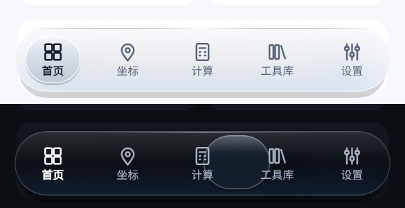
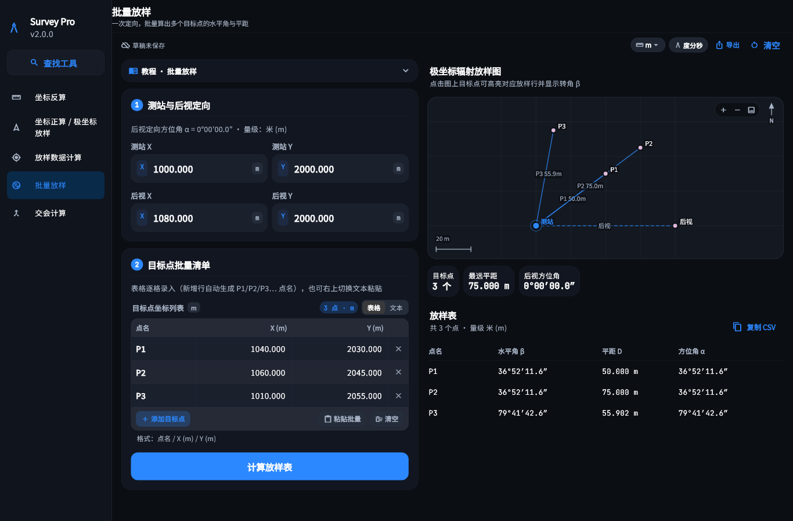
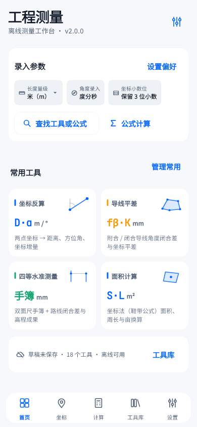
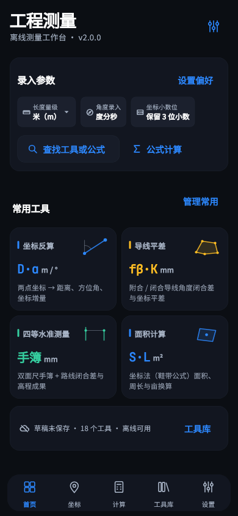
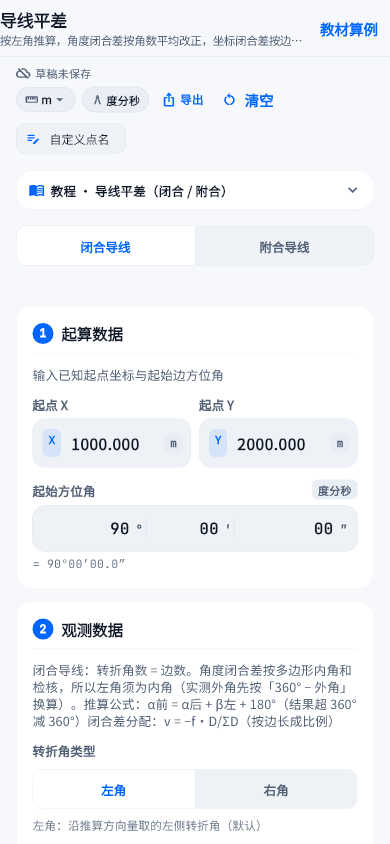

<div align="center">
  
  <h1>工程测量工具箱 · Survey Pro</h1>
  <p>面向工程测量现场和教学算例的离线工具箱，支持 Windows 和 Android。</p>
  <p>
    <a href="https://github.com/gtnb233-dev/GTnb233/releases/download/v2.1.1/survey_pro-2.1.1-windows-x64.zip"><strong>下载 Windows</strong></a> ·
    <a href="https://github.com/gtnb233-dev/GTnb233/releases/download/v2.1.1/survey_pro-2.1.1-android-arm64-v8a.apk"><strong>下载 Android</strong></a> ·
    <a href="https://github.com/gtnb233-dev/GTnb233/releases/tag/v2.1.1">查看 v2.1.1 发布说明</a> ·
    <a href="#源码与本地构建">源码与构建</a>
  </p>
</div>

## 下载与安装

当前正式版为 **v2.1.1**。

| 平台 | 适用设备 | 下载 |
| --- | --- | --- |
| **Windows x64 便携版** | Windows 10／11，解压即用 | [下载 ZIP](https://github.com/gtnb233-dev/GTnb233/releases/download/v2.1.1/survey_pro-2.1.1-windows-x64.zip) |
| **Android ARM64** | 大多数 64 位手机，推荐 | [下载 APK](https://github.com/gtnb233-dev/GTnb233/releases/download/v2.1.1/survey_pro-2.1.1-android-arm64-v8a.apk) |
| **Android 通用版** | 不确定设备架构时选择 | [下载 APK](https://github.com/gtnb233-dev/GTnb233/releases/download/v2.1.1/survey_pro-2.1.1-android-universal.apk) |
| Android ARMv7 | 旧款 32 位 Android 设备 | [下载 APK](https://github.com/gtnb233-dev/GTnb233/releases/download/v2.1.1/survey_pro-2.1.1-android-armeabi-v7a.apk) |
| Android x86_64 | x86_64 模拟器或设备 | [下载 APK](https://github.com/gtnb233-dev/GTnb233/releases/download/v2.1.1/survey_pro-2.1.1-android-x86_64.apk) |

- **Windows**：解压 ZIP 后运行 `survey_pro.exe`。请保留同目录的 `data/` 和 `flutter_windows.dll`。
- **Android**：需要 Android 7.0 或更高版本。可用官方 v2.1.1 APK 覆盖升级此前正式版。 [SHA-256 校验清单](https://github.com/gtnb233-dev/GTnb233/releases/download/v2.1.1/SHA256SUMS.txt)

## 核心亮点

- **100% 本地离线 · 19 项工程测量全覆盖**
  涵盖控制点库、四等水准（双面尺法实时检核与自动跳格）、导线平差、坐标正反算与交会、坐标转换（高斯/四参/七参）、曲线放样、断面/方格网/TIN 土方计算；内置 22 套离线教案与标准算例，断网可用。
- **Rust + Flutter 混合计算引擎**
  重计算模块（DXF 解析、TIN 三角网土方、2D 空间索引）由 `rust/survey_rust_core`（Dart FFI）驱动，并配备等价回退机制；角度底层全程 `f64` 弧度无损计算，支持 `DMS / DD / RAD` 随时切换。
- **全局 `LivePlot` 实时动态坐标图**
  严格工程坐标系（`X↑北 / Y→东`），随输入实时绘制点位、连线、闭合差与高程纵断面，支持 60fps 缩放平移、点选查坐标及宽屏右侧分屏联动。
- **Apple HIG 液态玻璃 + 840dp 响应式双模界面**
  浅色/深色/跟随系统三态无缝切换；Windows 桌面与 Android 平板横屏采用一体化顶栏与双列可折叠侧栏，Android 手机竖屏自动切换为侧推式抽屉与单层悬浮顶栏（支持跟手侧滑返回）。
- **防丢草稿与全离线多格式导出**
  输入自动防抖保存草稿并支持 Undo/Redo；成果支持导出 **2.5x 高清图片（Android 自动入相册）**、**含导线略图的 `.xlsx` 表格**、**UTF-8 BOM `.csv`** 及 **`.txt` 文本报告**，且界面与导出文件均支持全球多语言无残留切换。

## 界面语言

默认跟随系统语言。可在「设置 → 语言」手动选择简体中文、英语、绍纳语（ChiShona）、津巴布韦北恩德贝莱语（isiNdebele）、法语、葡萄牙语或西班牙语。应用会记住选择，切换语言无需联网。系统语言列表无可用译文时使用英语。

多语言覆盖导航、设置、首页、全部 19 项测量工具、弹窗、22 套离线教案、42 个结构化错误提示及 Excel / CSV / TXT / PNG 导出模板（英文模式通过全量零汉字 Zero-CJK 巡检，小语种缺失词条统一回退至英文）。语言设置沿用现有测量坐标约定。

## v2.0.5 液态玻璃导航

Android 和 Windows 窄窗口默认使用悬浮玻璃底栏。横滑时高亮胶囊随手指移动，松手后打开对应页面。点击入口也能直接切页。



## v2.0.0 界面预览

**Windows · 批量放样**  
左侧录入测站、后视和目标点，右侧查看放样图、关键数值和成果表。



**Android · 工作台与导线平差**  
首页可直接切换长度量级、角度录入方式和坐标小数位，也能搜索工具与公式。计算页支持表格粘贴、角度分格和教材算例。

<table>
  <tr>
    <td align="center"><br />浅色工作台</td>
    <td align="center"><br />深色工作台</td>
    <td align="center"><br />导线平差</td>
  </tr>
</table>

## 内置工具

| 分类 | 包含工具 |
| --- | --- |
| 坐标与放样 | 控制点库、坐标反算、坐标正算／极坐标放样、放样数据计算、批量放样、交会计算 |
| 控制测量 | 导线平差、水准路线平差、四等水准测量、精度估算 |
| 线路与曲线 | 圆曲线、缓和曲线、竖曲线、路线中桩坐标 |
| 面积与土方 | 面积计算、土方量计算（平均断面法／方格网法／TIN 三角网） |
| 计算与换算 | 公式计算器、坐标转换、角度与坡度换算 |

- **查找和录入**：Windows 使用 `Ctrl+K` 查找工具与公式。计算页本地保存草稿，支持逐格录入和批量粘贴。
- **绘图和检核**：交互式坐标图支持缩放和图表联动。专项图表包括方格网挖填图、竖曲线纵断面及水准成果图。
- **成果导出**：按工具支持 Excel、CSV、TXT 或 PNG，适合整理手簿、成果表和附图。

## 源码与本地构建

Windows 和 Android 共用 Flutter 界面与 Dart 测量核心。

| 目录 | 内容 |
| --- | --- |
| [`app/lib`](app/lib) | 工作台、测量工具、绘图、草稿与成果导出 |
| [`app/windows`](app/windows) · [`app/android`](app/android) | Windows 和 Android 平台工程 |
| [`packages/survey_core`](packages/survey_core) | 可独立运行与测试的 Dart 测量计算库 |
| [`app/test`](app/test) · [`tools`](tools) | 应用回归测试和构建辅助脚本 |

本版使用 Flutter **3.35.5** 和 Dart **3.9.2**。Windows 的常规构建需要 Visual Studio 的「使用 C++ 的桌面开发」工作负载。Android 需要 JDK 17 或更高版本及 Android SDK 36。 [Flutter Windows 环境](https://docs.flutter.dev/platform-integration/windows/setup) · [Flutter Android 构建说明](https://docs.flutter.dev/deployment/android)

```sh
git clone https://github.com/gtnb233-dev/GTnb233.git
cd GTnb233/app
flutter pub get
flutter analyze
flutter test
```

从 `app/` 目录按目标平台执行构建命令。

- **Windows** 运行 `flutter build windows --release`。使用 Zig 的 Windows x64 构建可从仓库根目录运行 `powershell -File tools/build_windows_zig.ps1`，需要 Zig、Python 3 和 Flutter 3.35.5，产物位于 `app/build/zig-windows/dist/survey_pro/`。
- **Android** 运行 `flutter build apk --release`。加入 `--split-per-abi` 可生成各架构 APK，产物位于 `app/build/app/outputs/flutter-apk/`。本地未配置发布密钥时使用调试签名。本地 APK 与官方 APK 的签名不同，因此需要使用独立的测试设备或测试环境安装。
- **测量核心** 在 `packages/survey_core/` 运行 `dart pub get` 和 `dart run test/all_test.dart`。

Windows 安装程序用 NSIS 3.x 生成。完成 Zig 版 Windows 构建后，在仓库根目录运行以下命令。

`powershell -File tools/build_windows_installer.ps1`

精简的 Noto Sans SC 字体保留界面字符和常用汉字。需要更新字体子集时，使用 Python 3 和 fontTools，执行 `python tools/subset_ui_font.py <完整的静态 Noto Sans SC Regular 字体>`。

## 许可证

项目自有源码采用 [MIT 许可证](LICENSE)。Flutter 平台模板保留 [Flutter BSD 许可证](docs/FLUTTER-LICENSE.txt)。随源码提供的字体分别保留 [Noto Sans SC](app/assets/fonts/survey/NotoSansSC-OFL.txt)和 [JetBrains Mono](app/assets/fonts/survey/JetBrainsMono-OFL.txt) 的 SIL Open Font License。

## 版本与反馈

- [最新版与下载校验](https://github.com/gtnb233-dev/GTnb233/releases/tag/v2.1.1)
- [历史版本](https://github.com/gtnb233-dev/GTnb233/releases) · [v1.2.0-beta.3](https://github.com/gtnb233-dev/GTnb233/releases/tag/v1.2.0-beta.3)
- [问题反馈](https://github.com/gtnb233-dev/GTnb233/issues) · 反馈计算或显示问题时，请附上应用版本、平台和可复现的输入示例。
